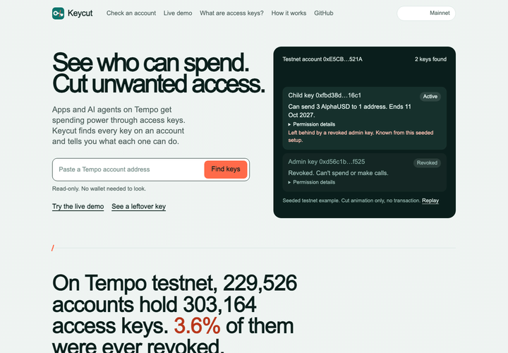
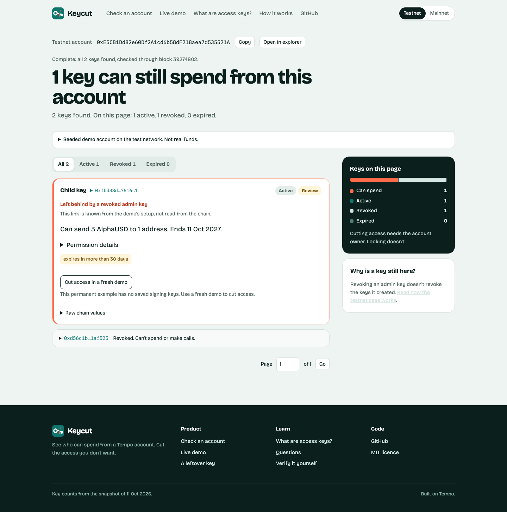
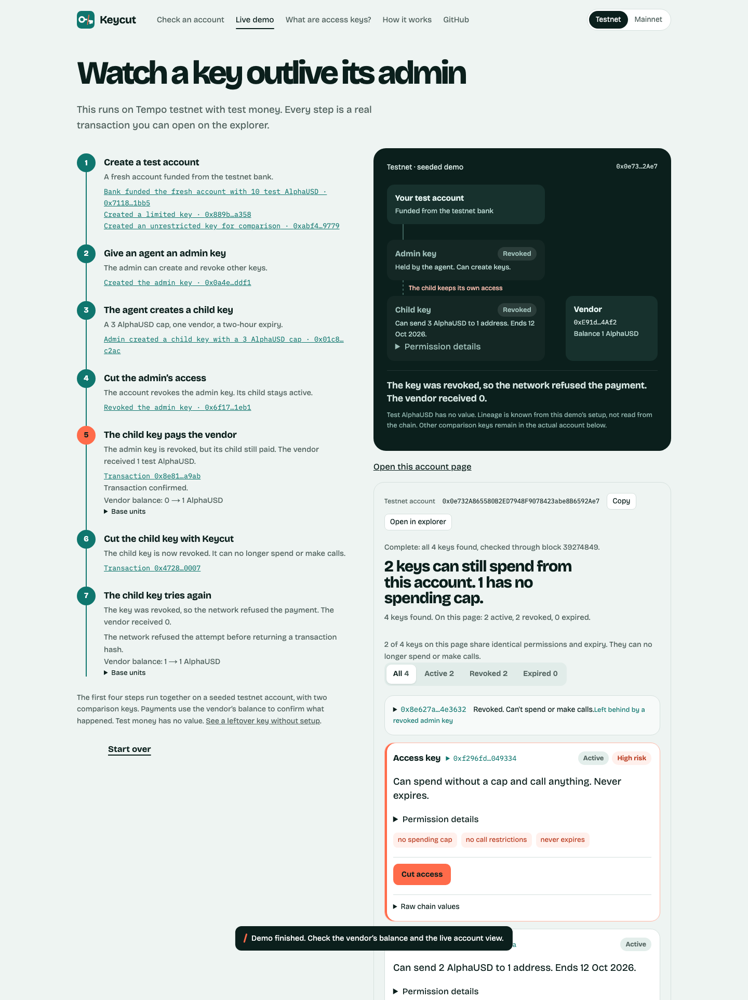
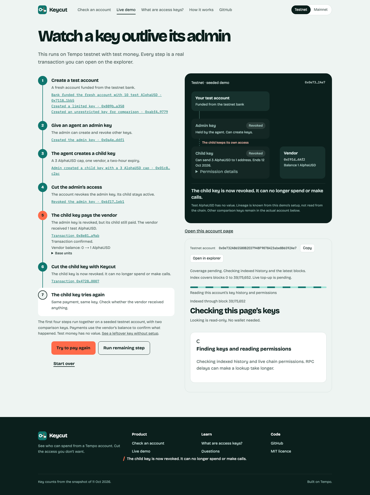
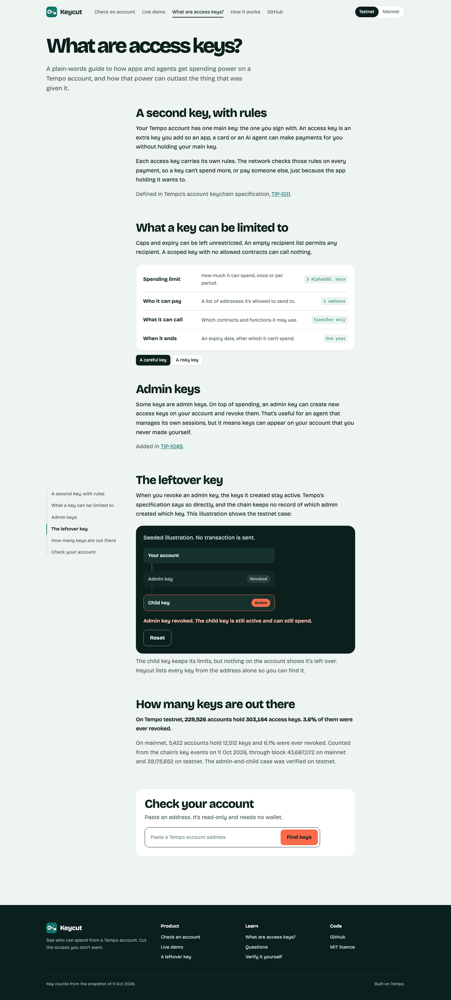
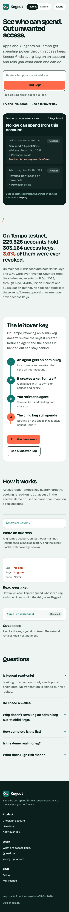

<p></p>

# Keycut for Tempo

See who can spend. Cut unwanted access.

[Live app](https://keycut.ajkadri.dev) · [Live demo](https://keycut.ajkadri.dev/demo) · [Permanent leftover key](https://keycut.ajkadri.dev/testnet/0xE5CB1Dd82e60Df2A1cd6b58dF218aea7d535521A)

[Demo video](https://youtu.be/w7cM7eyOgIA) · [Pitch video](https://youtu.be/ihl1y0YPkWU)

Keycut lists the access keys that can spend from a Tempo account and explains each one in plain words. Tempo's [TIP-1049](https://github.com/tempoxyz/tempo/blob/main/tips/tip-1049.md) leaves a child key active when its admin key is revoked, so an old agent can keep payment access after the agent is retired. Keycut finds that leftover access and lets the owner cut it with their own wallet, on testnet and mainnet.

<p></p>

<p></p>

<p></p>

## Try it in 60 seconds

1. Click "Create a test account" to fund a fresh throwaway testnet account from the demo bank.
2. The setup gives an agent an admin key that can create other access keys.
3. The agent creates a child key with a 3 AlphaUSD cap, one vendor and a two-hour expiry.
4. The demo cuts the admin key, while the child key stays active.
5. Click "Pay with the child key" and check the vendor balance change from 0 to 1 AlphaUSD.
6. Confirm "Cut access" to revoke the child key through the real keychain.
7. Click "Try to pay again" and check that the vendor balance stays unchanged.

The first four setup steps run together when you choose "Run every step". Every transaction link comes from the live Tempo testnet response. Test AlphaUSD has no value.

<details>
<summary>More screenshots</summary>

<p></p>

<p></p>

<p></p>

</details>

## Cut access with your own wallet

Owners can cut a key with their own Tempo Wallet on testnet and mainnet. Keycut only ever asks the wallet to sign `revokeKey`, and confirms the key reads as revoked on chain afterwards. Verified on both networks:

- [Testnet authorize](https://explore.testnet.tempo.xyz/tx/0x3fe4ad29a7cad615b3e3ef96b6b4d2b86c7a0b20079c61c952dda00e228d7ee4)
- [Testnet revoke](https://explore.testnet.tempo.xyz/tx/0xd51ea4b1978bb012c7b2b3d484230f9e088c8476cba3f33094372f5bbf3b7351)
- [Mainnet authorize](https://explore.tempo.xyz/tx/0x8719c2673ff50dc2c68529459f723399f97ff358ad8a3deb1ba1611cbed2efec)
- [Mainnet revoke](https://explore.tempo.xyz/tx/0x728de0de61c49c9ae93848d057031dbfb2e2ac2a73eb2a051aa494057f3d11c2)

## Numbers

On Tempo testnet, 229,526 accounts hold 303,164 access keys. 3.6% of them were ever revoked.

On mainnet, 5,422 accounts hold 12,512 keys and 6.1% were ever revoked. There are no admin keys on mainnet yet.

These figures come from the committed index snapshots dated 11 Oct 2026: [testnet metadata](public/index/42431/meta.json) and [mainnet metadata](public/index/4217/meta.json). They are snapshot counts, not a claim about current totals.

## How it works

Keycut discovers `KeyAuthorized`, `AdminKeyAuthorized` and `KeyRevoked` events from the Tempo account keychain. It starts with committed shards, tops up from the latest block, and reports the exact covered range or a partial result.

For each page, it reads `getKey`, `isAdminKey`, `getAllowedCalls` and active capped-key allowances. Multicall3 batches the permission reads on both chains after parity checks against direct reads. The UI builds each card from these raw fields, so the sentence, status, risk flags and expandable details stay consistent.

The demo uses a pre-funded testnet bank and fresh server-generated throwaway keys. Payment outcomes come from the vendor's balance and confirmed key state. A connected account owner can cut an active key through Tempo Wallet on either network.

## Verify it yourself

Open the [live demo](https://keycut.ajkadri.dev/demo), the [permanent leftover key](https://keycut.ajkadri.dev/testnet/0xE5CB1Dd82e60Df2A1cd6b58dF218aea7d535521A), or the [known four-key account](https://keycut.ajkadri.dev/testnet/0x907B843c995E9332caf4A0A832B2B1fbCD1E9477). Then run the public verifier:

```sh
npm ci
npm run verify
```

`scripts/verify.ts` prints the four known keys and their covered block range from the product index plus top-up, then runs the leftover-key case on a fresh testnet account. It prints `PASS` or `FAIL` for each claim and exits nonzero on failure. Expected claims include:

```text
PASS Product finds the four known keys from the address
PASS Two known keys are revoked
PASS Discovery covers all history through the latest captured block
PASS Live permissions are available
PASS Admin key issues the child key
PASS Product batches active capped permissions correctly
PASS Child pays before revocation
PASS Child still pays after its admin key is revoked
PASS Revoking the child stops its payment
```

## Safety and operations

The product never accepts or stores a private key from the browser. Demo keys are throwaway testnet keys generated on the server, and demo routes accept only chain 42431. Demo creation is rate-limited per IP, and lookup requests have a per-IP limit. Server setup, environment variables, bank maintenance, rate limits and index operations are documented in [docs/OPERATIONS.md](docs/OPERATIONS.md).

## Licence

Keycut is released under the [MIT License](LICENSE).
