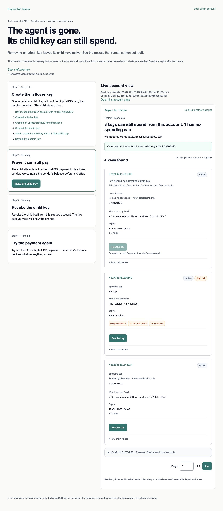
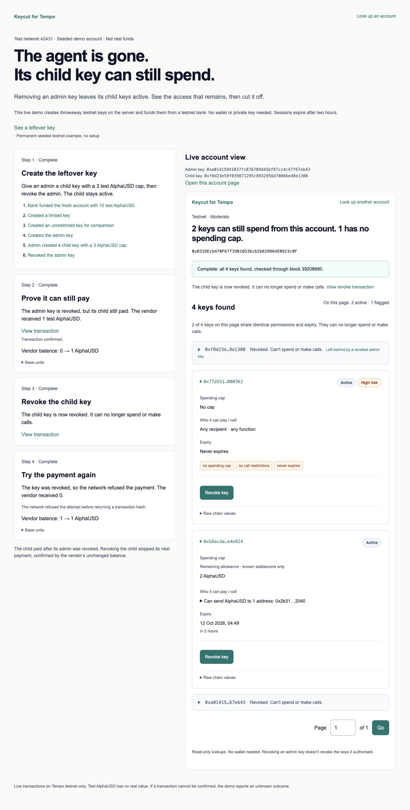

# Keycut for Tempo

See who can spend. Cut unwanted access.

Keycut shows every access key that can spend from a Tempo account, explains each one in plain words, and helps the owner cut off the ones they don't want. It is for teams that give AI agents and apps permission to pay on Tempo.

[Live app](https://keycut.ajkadri.dev) · [Live demo](https://keycut.ajkadri.dev/demo) · [Permanent example](https://keycut.ajkadri.dev/testnet/0xE5CB1Dd82e60Df2A1cd6b58dF218aea7d535521A) · Demo video: coming

## The problem

Apps and agents get spending power through access keys. An account can collect many keys over time. The chain has no function that lists them, and no tool we found lists these keys. Token-approval checkers don't cover access keys.

Our indexed snapshots from 11 Oct 2026, 20:16 UTC show:

| Network | Keys | Accounts | Keys ever revoked |
|---|---:|---:|---:|
| Testnet | 303,164 | 229,526 | 10,990 (3.6%) |
| Mainnet | 12,512 | 5,422 | 764 (6.1%) |

These are dated snapshots from the [testnet](public/index/42431/meta.json) and [mainnet](public/index/4217/meta.json) metadata, not current totals. Each account lookup tops up its history and reads current permissions, with coverage shown.

An agent’s admin key can create a child key, and revoking the admin leaves that child able to pay. Keycut shows the remaining access, then the owner revokes the child and its next payment is refused, as demonstrated on Tempo testnet only.

## Walk through the leftover key

All demo accounts are seeded testnet accounts. Test AlphaUSD isn't real money.

1. Open the [live demo](https://keycut.ajkadri.dev/demo) and choose Create demo account. A testnet bank funds a fresh account. An admin creates a child with a 3 AlphaUSD cap and one allowed vendor, then the owner revokes the admin. The actual account panel shows the child first. Its admin link is known from setup, not inferred from the chain.

   

2. Choose Make the child pay. The child sends 1 AlphaUSD after its admin was revoked. The vendor’s balance goes from 0 to 1 AlphaUSD, proving the payment. The transaction link is shown.
3. Choose Revoke key on the child card, or Revoke the child key in step 3. The chain revokes it, and its card becomes a compact revoked row.
4. Choose Attempt the payment. The vendor’s balance stays at 1 AlphaUSD, so it received 0. The explanation uses the unchanged balance and confirmed revocation. A refusal before broadcast has no transaction link. An uncertain outcome is reported as unconfirmed.

   

The [permanent example](https://keycut.ajkadri.dev/testnet/0xE5CB1Dd82e60Df2A1cd6b58dF218aea7d535521A) needs no setup. Its child has a small cap and a finite one-year expiry. Its signing keys were discarded, so its revoke action opens a fresh demo. Real accounts have an exact owner-client command to copy; connected-wallet revoke isn't built.

## Wallet revoke gate

The testnet wallet gate on 12 Oct 2026 did not pass in the available browser. Tempo Wallet through the [Tempo Accounts SDK](https://github.com/tempoxyz/accounts) reached passkey sign-in on the hosted HTTPS origin, but no account connected. The default popup was unavailable to the browser tools, and native passkey controls were blocked by a locked Mac. A local attempt also returned a WebAuthn TLS error. No injected wallet was available. No revoke transaction was signed, so main-key versus session-key signing and `getKey.isRevoked` remain unverified. Wallet revocation remains unverified. Real accounts keep the owner-client command to copy, and mainnet wallet actions remain unavailable.

## How Tempo is used

Keycut reads Moderato testnet (42431) and Tempo mainnet (4217) through `viem@2.57.4`. All writes are testnet-only.

The account keychain at `0xaAAAaaAA00000000000000000000000000000000` emits `KeyAuthorized`, `AdminKeyAuthorized` and `KeyRevoked`. Keycut indexes these events into static shards, then scans later account events during lookup. Failed ranges remain visible as partial coverage. The chain doesn't record which key authorised another key in these events.

Permissions come from `getKey`, `isAdminKey`, `getAllowedCalls` and `getRemainingLimitWithPeriod` at one captured block. Page-wide reads use Multicall3 at `0xcA11bde05977b3631167028862bE2a173976CA11`, checked against direct reads on both chains. Only active capped keys get allowance reads. Aggregate failures use bounded direct reads; unresolved failures remain partial.

The admin creates its child with `authorizeKey`. The owner’s `client.accessKey.revokeSync({ accessKey: keyId })` calls `revokeKey` on that child. Payments use TIP-20 `transfer` with explicit gas. Vendor balances decide whether anything arrived.

Allowances cover a fixed list of known stablecoins. Other tokens aren't covered, and `transferFrom` isn't covered by spending limits. Full permissions and addresses remain expandable.

## Verify it yourself

A judge can check the [hosted demo](https://keycut.ajkadri.dev/demo) without a wallet, or open the [permanent example](https://keycut.ajkadri.dev/testnet/0xE5CB1Dd82e60Df2A1cd6b58dF218aea7d535521A) with no setup. The [known four-key account](https://keycut.ajkadri.dev/testnet/0x907B843c995E9332caf4A0A832B2B1fbCD1E9477) shows two revoked keys and live coverage. Expand raw values and follow the transaction links to check the evidence.

For an independent live check, run:

```sh
npm ci
npm run verify
```

It prints the known keys and covered block ranges using the product’s index plus top-up, then runs the leftover-key case on a fresh seeded testnet account. Expected claims include:

```text
PASS Product finds the four known keys from the address: 4 keys found using the product index plus top-up
PASS Two known keys are revoked: 2 revoked keys
PASS Discovery covers all history through the latest captured block: Complete: all 4 keys found, checked through block <block>.
PASS Live permissions are available: permissions read at block <block>
PASS Admin key issues the child key: <explorer link>
PASS Product batches active capped permissions correctly: fresh child allowance 20000000 base units; reads via multicall3
PASS Child pays before revocation: vendor balance change 1000000 base units
PASS Child still pays after its admin key is revoked: admin revoked=true, vendor balance change 1000000 base units
PASS Revoking the child stops its payment: revoked=true, vendor balance change 0 base units
```

Each claim prints PASS or FAIL. Any failure exits nonzero. This optional verifier uses faucet funds once per run and never writes to mainnet. The public demo uses its pre-funded bank.

## What is shipped

| State | What it covers |
|---|---|
| Live | Address discovery, history top-up, current permissions, raw values, pagination and coverage on both networks. Testnet demo payments, child revocation and balance-based refusal. |
| Seeded | Fresh testnet demo accounts and one permanent leftover example. The child/admin relationship is known only from setup. |
| Snapshot | Network counts and key history in dated committed shards. Account lookups read later events. |
| Simplified | Allowances for known stablecoins only. Risk labels flag broad access, admin keys and expiry beyond 30 days. Unknown spending access stays explicit. RPC latency can vary. |
| Not built | Connected-wallet revoke for real accounts, inferred lineage, spend history, scheduled refresh, team alerts or automatic revoke. Real accounts get a command to copy. |

Server setup, environment variables, rate limits, bank maintenance and index operations are in [OPERATIONS.md](docs/OPERATIONS.md). The [1024px PNG logo](public/logo.png) and [MIT license](LICENSE) are included.

## What comes next

- Wallet revoke for real accounts.
- Key lineage backed by verified authorisation evidence.
- Spend history per key.
- Alerts for teams.
